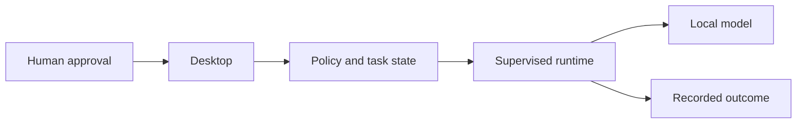

# AIOS

[Back to my profile](../README.md)

AIOS is a personal project about running AI-assisted tasks locally without giving a model unrestricted control of the computer.

The main question I'm exploring is how to keep a clear boundary between what a model suggests and what the software is actually allowed to execute. A person should be able to set permissions, inspect task states and understand what happened during a run.

## How I'm approaching it

I'm using Python for orchestration and runtime behavior, Rust and Tauri for the native desktop boundary, Vue/TypeScript for the interface and Ollama for local model integration.

The design separates four parts:

- A desktop interface for reviewing tasks and requesting approval
- Core state for tasks, runs and recorded outcomes
- Policy checks that decide which actions are permitted
- A supervised runtime that executes approved work

This is the intended separation, not a claim that every part is production-ready.

## Problems I've been working through

**Permissions.** Model output cannot grant itself new authority. The checks need to live outside the UI and outside model-generated instructions.

**Uncertain results.** If an action times out, that doesn't necessarily mean it failed. The system needs to record what is known instead of guessing at an outcome.

**Windows process supervision.** Tracking and reliably stopping child processes has exposed edge cases in process ownership and lifecycle handling.

**Local models.** I've tested an Ollama-backed run with a real model response, but that's an integration check rather than evidence of production reliability.

I use controlled test providers and automated tests to exercise these behaviors without depending on a model for every test.

AIOS is still in development. The code and internal tests are private, and I haven't published a runnable release or demo yet. I plan to review the release and security implications before making any of that public.
