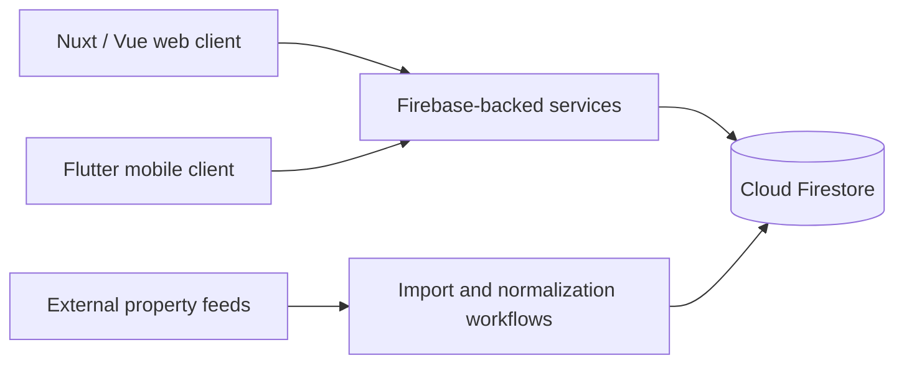

# CBienLà — Real estate web and mobile platform

[Back to profile](../README.md) · [Product website](https://cbienla.fr)

**Team project · Full-stack product engineering · Source code private**

## Context

CBienLà is a real-estate platform developed with a team of five. The product brings together web and mobile experiences with shared backend services, integrations and tools for managing business workflows.

My involvement has included full-stack engineering and automation across the product. This is **team work, not a claim of sole ownership**.

## Technology

| Layer | Technologies |
| --- | --- |
| Web | Nuxt 4, Vue 3, TypeScript |
| Mobile | Flutter, Dart |
| Backend | Firebase Cloud Functions, Node.js / TypeScript |
| Data & authentication | Firebase and Cloud Firestore |
| Delivery | GitHub Actions and automated checks |
| Integrations | External real-estate feeds and third-party services |

## Engineering areas

**Multi-client consistency.** Web and Flutter clients connect to shared data and business operations. Changes need consistent behavior across platforms and clear boundaries between the interface, backend and data rules.

**Data ingestion.** Integrations import and normalize external property-related information. This work entails validating incoming data, managing incomplete fields and handling differences between source formats.

**Business workflows.** The platform supports operational features such as lead-management and administrative flows, requiring authorization checks and predictable state updates.

**Delivery and maintenance.** Engineering includes CI/CD, debugging, validation and incremental changes in an active multi-contributor repository.

## Simplified system view

This is a **portfolio-level illustration**, not an exact diagram of internal infrastructure or security controls.

### Public evidence and media

- **Live public product:** [cbienla.fr](https://cbienla.fr), featuring property search, listings and professional discovery
- **Private work:** source history, back-office flows and integration code are not published here
- **Screenshots:** a public-page screenshot or redacted demo could be added after confirming rights and removing personal or business data; no such screenshot is included at present

## What this case study demonstrates

- Working with an interconnected **web + mobile + serverless** codebase
- Practical experience with TypeScript, Vue/Nuxt, Flutter and Firebase
- Navigating complex product workflows and external data integrations
- Collaborating within a small product team, including testing and delivery

## Scope and verification

The [product website](https://cbienla.fr) is a public entry point. **The private source code, client information, internal architecture specifics and operational credentials are intentionally not included.** This document is a high-level technical overview, not an independent security audit or a claim of publicly verified performance.

Additional sanitized screenshots or architecture diagrams may be added after review of ownership and confidentiality constraints.
