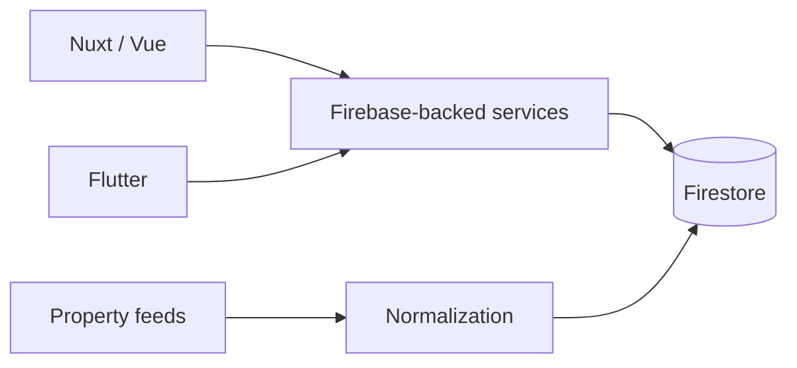

# CBienLà — Real-estate platform

[← Back to my profile](../README.md) · [Explore the live product](https://cbienla.fr/) · [Meet the team](https://cbienla.fr/qui-sommes-nous)

**Team product · Web, mobile and backend · Source code private**

CBienLà is a French real-estate platform for property discovery and interactions with professionals. I contribute to its engineering in a five-person team, with a particular focus on data consistency, business workflows and reliable delivery.

## Three engineering contributions

### 1. Keeping property data consistent across web and mobile

**Problem.** A French postal code starting with zero could lose that zero when treated as a number, producing incorrect location data.

**Work.** Contributed to aligning the Nuxt/TypeScript and Flutter/Dart data models around five-character postal-code strings, updating validation and ingestion, and accommodating historical numeric records. A staged data-cleanup path was prepared to avoid breaking older records.

**Why it matters.** A small data-type choice affects search behavior, multiple clients, stored documents and rollout safety. The improvement addressed the whole data flow rather than only its display.

### 2. Handling incomplete contact requests safely

**Problem.** Some legitimate administrative contact requests arrive without an email address or phone number, but the application needed to preserve validation for normal public submissions.

**Work.** Contributed to an admin-only workflow for handling these incomplete records, including access checks, correction history, conflict handling and compatibility with older records. The change was validated with targeted tests and browser-level scenarios.

**Why it matters.** Real business requirements often need exceptions; implementing them safely requires maintaining data integrity, traceability and a clear boundary between administrative and public permissions.

### 3. Detecting regressions before deployment

**Problem.** A page can return successfully while failing to display the expected business content. Shared test environments also risk unintentionally interacting with live services.

**Work.** Helped establish isolated Firebase emulator-based end-to-end testing with Playwright in pull-request CI, then extended coverage for property listings, published articles, FAQs and content visibility. Negative test scenarios were used to check whether the tests actually detected deliberately introduced regressions.

**Evidence.** At a documented November 2026 revision, **19 of 19 end-to-end checks passed in private CI**. This is a historical result for a defined revision, not a claim that every current or production workflow is covered.

## Technical context

| Layer | Technology |
| --- | --- |
| Web | Nuxt 4, Vue 3, TypeScript |
| Mobile | Flutter, Dart |
| Services | Firebase Cloud Functions, Node.js / TypeScript |
| Storage & data | Firebase, Cloud Firestore |
| Quality & delivery | Playwright, automated tests, GitHub Actions |
| Integrations | External property-data feeds |

*Simplified public-facing illustration, not a detailed map of internal services or security controls.*

## Explore the real product

- [Property search and homepage](https://cbienla.fr/)
- [Property discovery by region](https://cbienla.fr/immobilier)
- [Professional directory](https://cbienla.fr/professionals)

These are public pages demonstrating the **team's product**, not proof that I individually built every visible feature.

## Scope and confidentiality

This portfolio page is based on work reflected in contributions under my GitHub account in the team's private repository. It describes **my areas of contribution**, not sole authorship of the product or every code change. Private pull requests, proprietary source, internal operational details and personal/customer data are not reproduced.

No screenshots are included because branding, listing photos and other third-party material require a separate rights and privacy review. Public product links provide a verifiable preview in the meantime. Tests described here are development/CI results, not a certification of production behavior.
