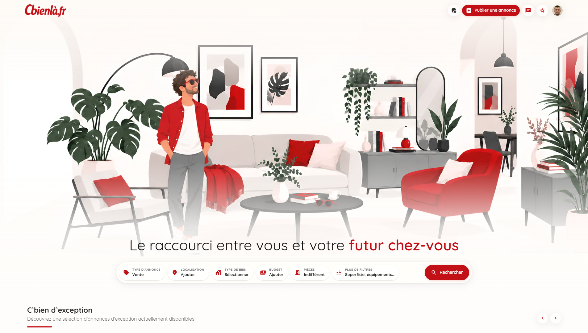

# CBienLà

[Back to my profile](../README.md) · [Visit cbienla.fr](https://cbienla.fr/)

CBienLà is a French real-estate platform that I'm building with four teammates. I co-founded the project in October 2025 and work on both the product and its technical implementation.

My work spans the Nuxt/Vue frontend, the Flutter mobile app and Firebase services. That includes user-facing features, integrations, data workflows and deployment automation. The technologies I use here include TypeScript, Node.js, Firestore and Dart.

It's a collaborative product, so this page focuses on the work I've contributed rather than presenting the whole platform as mine.

## Screenshots

The screenshots below show the public-facing product.

### Home page

### Property search

You can explore the product at [cbienla.fr](https://cbienla.fr/). The application code is private.
