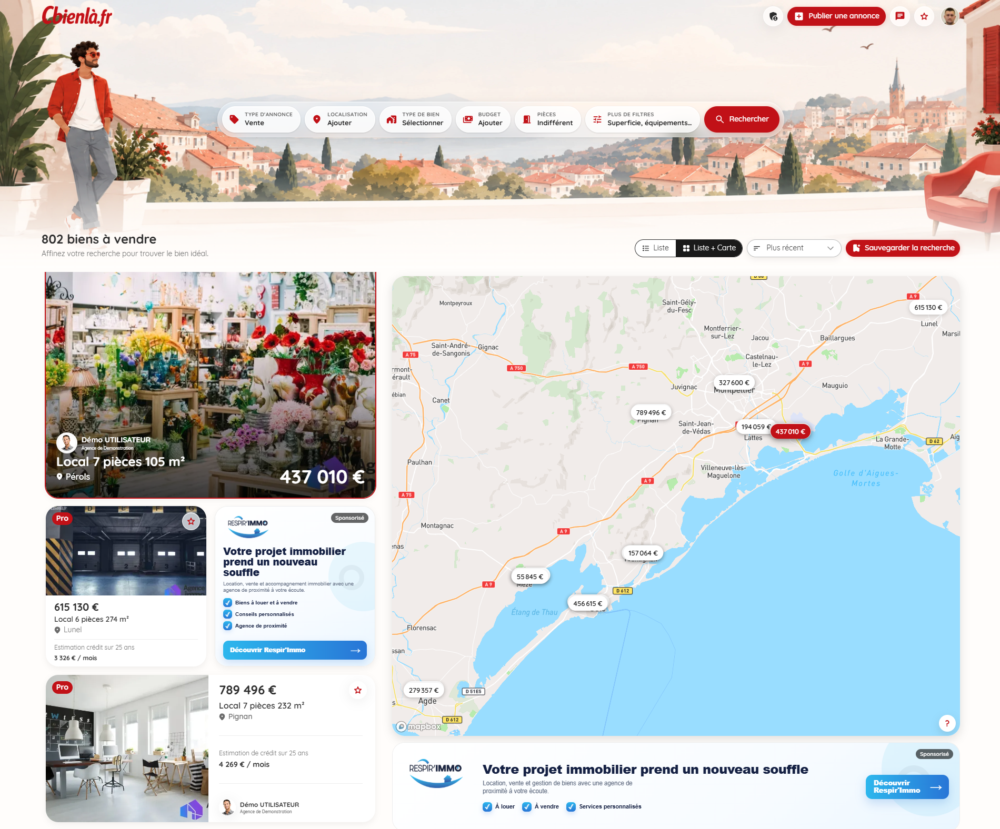

# CBienLà — Web & mobile real-estate platform

[← Back to my GitHub profile](../README.md) · [Visit CBienLà](https://cbienla.fr/)

**Real product · Team project · Private source code**

CBienLà is a French real-estate platform available on the web and mobile. I contribute to its development as part of a team of five.

## See the product

**[Explore CBienLà on its official website](https://cbienla.fr/)**

The official website is the best way to see the public product today.

## Gallery

### Homepage

### Property Search

*Screenshots of the public-facing product, provided for portfolio illustration. They do not include the application's private source code or internal implementation.*

## My role

**Software developer — team contribution**

I work on the product's development and evolution with the team. This overview intentionally does not disclose private implementation details, internal workflows, architecture or security arrangements.

*This is a portfolio presentation of a collaborative product, not a claim of sole authorship or a public source-code release.*
